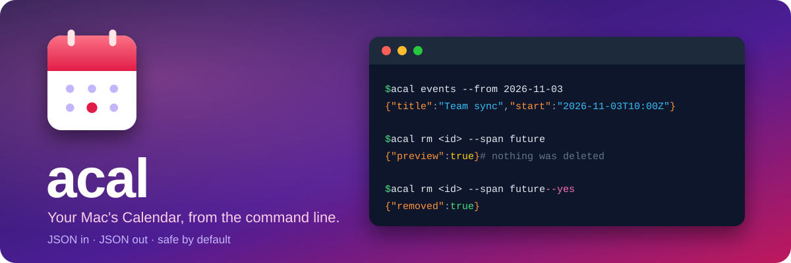

<div align="center">



<br>

[](https://github.com/jinhuang712/apple-calendar-cli/actions/workflows/test.yml)
[](LICENSE)


**English** · [简体中文](README.zh-CN.md)

</div>

## ✨ What it is

`acal` reads and writes the events in macOS Calendar. It works with every account Calendar knows about (iCloud, Google, Exchange and more), because it talks to the system's calendar store, not to one service.

- 🔌 **Made to be piped.** Lists are one JSON object per line. Results go to stdout, hints to stderr, and the exit code tells you what happened.
- 🛡️ **Safe when nobody is watching.** Deleting, and changing a repeating event, only show a preview until you add `--yes`. A repeating event always needs an explicit `--span`.
- 🎯 **One thing per command.** No search, no free-time finder, no config file. Filter with `jq`.
- 🔁 **Repeating events done properly.** Change one occurrence, or this and every later one.
- 📡 **Subscribed calendars too.** Add, remove and refresh them.
- 🤖 **Ships with a skill** that teaches Claude Code to use it without hurting your calendar.

> [!TIP]
> Anything that deletes, or changes a repeating event, prints a preview and stops. Read it, then run the same command again with `--yes`.

## 👀 A taste

The data below is made up; the shape of the output is real.

```console
$ acal events --from 2026-11-03 --to 2026-11-04 | jq -c '{title, start, calendar}'
{"title":"Team sync","start":"2026-11-03T10:00:00Z","calendar":"Work"}
{"title":"Dentist","start":"2026-11-03T15:00:00Z","calendar":"Personal"}

$ acal add --title "Gym" --start 2026-11-05T07:00:00Z --end 2026-11-05T08:00:00Z \
    --repeat weekly --count 4 --alarm 15m
{"allDay":false,"calendar":"Personal","id":"…","recurrenceRule":{"count":4,"frequency":"weekly","interval":1},…}

$ acal rm <id> --span future --occurrence 2026-11-12T07:00:00Z      # a preview, nothing is deleted
{"events":[{"start":"2026-11-12T07:00:00Z","title":"Gym",…},{"start":"2026-11-19T07:00:00Z","title":"Gym",…}],"preview":true}

$ acal rm <id> --span future --occurrence 2026-11-12T07:00:00Z --yes
{"events":[…],"removed":true}
```

## ⌨️ Commands

| To do this | Run |
|---|---|
| See or request calendar access | `acal auth [--request]` |
| List calendars | `acal calendars` |
| List events in a time range | `acal events --from <time> --to <time> [--calendar <name or id>]` |
| Show one event in full | `acal event <id> [--occurrence <time>]` |
| Create an event | `acal add --title … --start … --end … [--all-day] [--alarm 30m] [--repeat weekly --count 4]` |
| Change an event | `acal edit <id> [fields] [--occurrence <time>] [--span this\|future] [--yes]` |
| Delete an event | `acal rm <id> [--occurrence <time>] [--span this\|future] [--yes]` |
| Add a subscribed calendar | `acal subscribe <webcal:// or https:// address>` |
| Remove a subscribed calendar | `acal unsubscribe <calendar id> [--yes]` |
| Reload all calendars | `acal refresh` |

Times are ISO 8601. A time without an offset is read in your system time zone, and a bare date means the start of that day (the end of it for `--to`). Every command has `--help`.

What each command does, what it prints when something fails, and what is deliberately left out: see [FEATURES.md](FEATURES.md) (in Chinese).

## 📦 Install

You need macOS 14 or later and a Swift toolchain (Xcode or the command line tools).

```bash
git clone https://github.com/jinhuang712/apple-calendar-cli.git
cd apple-calendar-cli
swift build -c release
ln -s "$PWD/.build/release/acal" ~/.local/bin/acal    # or put it anywhere on your PATH
```

Then give your terminal access to Calendar. Run `acal auth --request`, click **Allow**, or turn it on in **System Settings → Privacy & Security → Calendars** (choose Full Access). Check with `acal auth`.

Shell completion for zsh, bash or fish: `acal --generate-completion-script zsh`.

### 🤖 For Claude Code: install the skill

The skill tells an agent how to use `acal` safely: preview before `--yes`, spans for repeating events, what needs a human click. One line:

```bash
curl -fsSL https://raw.githubusercontent.com/jinhuang712/apple-calendar-cli/master/install.sh | sh
```

It puts [`skills/apple-calendar/SKILL.md`](skills/apple-calendar/SKILL.md) into `~/.claude/skills/apple-calendar/`, and running it again overwrites it. It installs the skill only, not `acal` itself.

## 💡 Good to know

> [!IMPORTANT]
> **Access belongs to your terminal, not to `acal`.** If you switch from one terminal app to another, allow the new one too.

- **Subscriptions go through the Calendar app.** `subscribe`, `unsubscribe` and `refresh` drive Calendar's own scripting interface, because the system calendar framework cannot manage subscriptions. Your terminal must also be allowed to control Calendar (**Privacy & Security → Automation**).
- **`subscribe` needs a human.** Calendar shows two windows; someone has to confirm both. The command returns as soon as it has opened them.
- **`refresh` reloads every calendar,** and cannot tell you whether new content arrived.
- **What cannot be done:** adding or answering invitees, writing to subscribed or birthday calendars, attachments.
- Tested on macOS 27 on Apple silicon. Other versions and Intel Macs are untested.

## 📚 Documents

| | |
|---|---|
| [FEATURES.md](FEATURES.md) | What every command does, and what it will not do (Chinese) |
| [DESIGNS.md](DESIGNS.md) | The design principles and why the odd choices were made (Chinese) |
| [CHANGELOG.md](CHANGELOG.md) | What changed in each version |
| [CONTRIBUTING.md](CONTRIBUTING.md) | How to build, test and send a change |
| [SECURITY.md](SECURITY.md) | How to report a security problem |

## 📄 License

[MIT](LICENSE)
